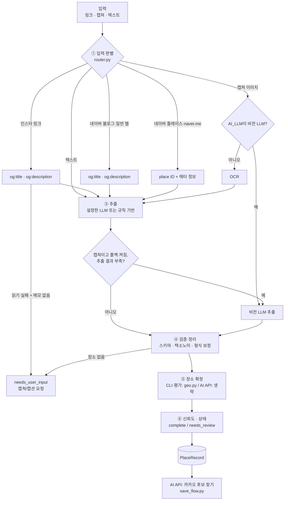

# 워크플로우 설계

저장 파이프라인(`placeflow/pipeline.py`)의 현재 동작입니다. AI 내부 API는 이 결과를 받아 카카오 검색으로 후보를 찾습니다(`v3/save_flow.py`).

## 단계별 책임

| 단계 | 모듈 | 입력 → 출력 | 실패 시 |
|---|---|---|---|
| ① 판별 | `router.py` | 문자열 → `RoutedInput(kind, source_type, ids)` | 알 수 없으면 일반 웹링크/텍스트로 처리 |
| ② 수집 | `fetchers/` | URL → `FetchedContent(title, text, status)`. 기본은 메타 정보만 | 읽지 못하고 메모도 없으면 **사용자에게 캡쳐 요청** |
| ② 이미지 | `llm` 비전 / `ocr.py` | 이미지 → 이미지 바이트 또는 OCR 텍스트 | 둘 다 없으면 `failed` |
| ③ 추출 | `llm/providers.py`, `heuristic.py` | 프롬프트 → `ExtractionResult(places[])` | LLM 오류 시 규칙 기반으로 대체(이미지가 없는 입력만) |
| ③ 폴백 | `pipeline._needs_vision` | 캡쳐 + 부족한 OCR 결과 → 비전 LLM 결과 | 호출 실패 시 OCR 결과 유지, 결과가 없으면 `failed` |
| ④ 정리 | `pipeline._sanitize`, `models.py` | 원시 JSON → 검증된 모델 | 스키마 밖 값은 `other`/null 로 |
| ⑤ 확정 | `geo.py` | 이름·주소 단서 → 지도 후보 + 점수 | 점수 < 0.75 → 주소 단서만 저장, `needs_review` |
| ⑥ 상태 | `pipeline._to_record` | → `PlaceRecord` | 사유를 `review_reasons` 에 기록 |

## 비전 LLM 폴백 조건
`AI_VISION_FALLBACK`(CLI `--vision-fallback`)을 켠 캡쳐 입력에서, OCR + 규칙 기반 결과가 아래 중 하나일 때 실행합니다.
- 장소가 없음
- 장소 하나라도 확신도 0.5 미만 (`PipelineConfig.ocr_accept`)
- 캡쳐마다 다른 상호가 보임
- OCR 오류로 텍스트가 없음

LLM이 응답하면 그 결과로 바꿉니다. "장소 없음" 응답이면 `needs_user_input`입니다. 잘린 응답이나 형식 오류는 1번 다시 시도합니다. SDK 오류는 SDK의 재시도에 맡깁니다. LLM이 지역 단서를 주지 않으면 OCR이 읽은 글에서 가장 많이 나온 동네 이름을 씁니다.

## AI 내부 API의 후보 찾기
AI 내부 API는 파이프라인의 ⑤를 쓰지 않습니다(`geo=none`). 추출한 장소를 `save_flow.candidates_from_records`가 카카오 로컬로 다시 검색해 장소별 묶음과 `EXACT`/`SIMILAR` 판정을 만듭니다. 판정 규칙은 [API_CONVENTION.md](API_CONVENTION.md)에 있습니다. 레코드의 지역 단서(`지역 단서:` 근거)를 검색어와 다른 지역 판정에 씁니다.

## 신뢰도 계산
- 지도 확정 성공: `overall = 0.5 × 추출 확신도 + 0.5 × 지도 매칭 점수`
- 지도 확정 실패: `overall = min(추출 확신도, 0.6)` → 항상 `needs_review`
- 지도 미사용(geo=none): `overall = 추출 확신도 × (주소 있으면 0.85, 없으면 0.7)`
- `overall ≥ 0.7` 이고 검토 사유가 없을 때만 `complete`

## 지도 매칭 점수 (`geo.score_candidate`)
- 이름 유사도(정규화 후 완전일치 1.0 / 포함 0.9 / 그 외 SequenceMatcher)
- 주소 단서가 있으면 `0.6 × 이름 + 0.4 × 주소 토큰(구·동·로·길) 겹침 비율` → **같은 상호의 다른 지점을 걸러냄**
- 지역 단서만 있으면 일치 시 +0.05, 불일치 시 ×0.9

## 카테고리 결정 순서
1. LLM(또는 휴리스틱)이 택소노미 안에서 고른 값
2. 지도 API 카테고리가 다른 대분류를 가리키면 **지도 기준**으로 바꾸고 사유 기록
3. 휴리스틱 키워드 규칙: 짧은 텍스트(상호명)는 **마지막 핵심어**("바다정원 글램핑" → 숙소), 긴 본문은 **처음 나온 키워드**, 구체 키워드가 "카페·맛집" 같은 일반 키워드보다 우선

## 중복 처리 (`dedupe_key`)
`kakao:{id}` → `naver:{id}` → `name:{상호+지점}@{시군구}` 순서. 같은 키가 다시 들어오면 출처를 합치고 비어 있는 값만 채웁니다.

## 추천 단계와의 관계
- 현재 추천 엔진(`v3/recommend.py`)은 Spring이 요청에 담아 보낸 저장 장소와 카카오 외부 후보를 씁니다. 파이프라인 레코드를 직접 읽지 않습니다.
- `embedding_text`는 레코드에 만들어 두지만 현재 추천에는 쓰지 않습니다.

## 로컬 전용 v0.2 흐름
`/legacy` 화면에서는 저장 뒤 정보 보강(`enrich.py`)과 컨셉 코스 추천(`route.py`)을 씁니다. 내부 API의 추천과는 별개입니다. 규칙은 [03_product_plan.md](03_product_plan.md) 부록에 있습니다.
